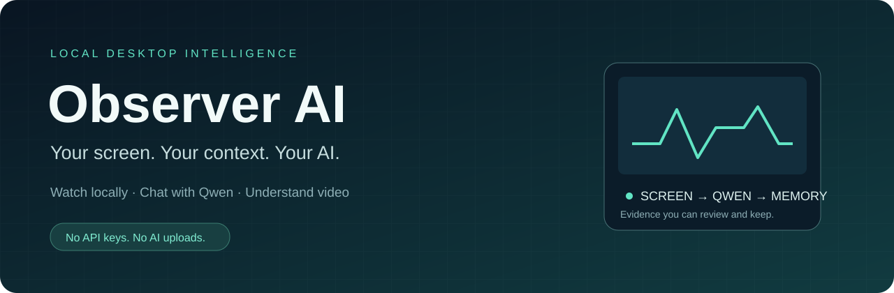
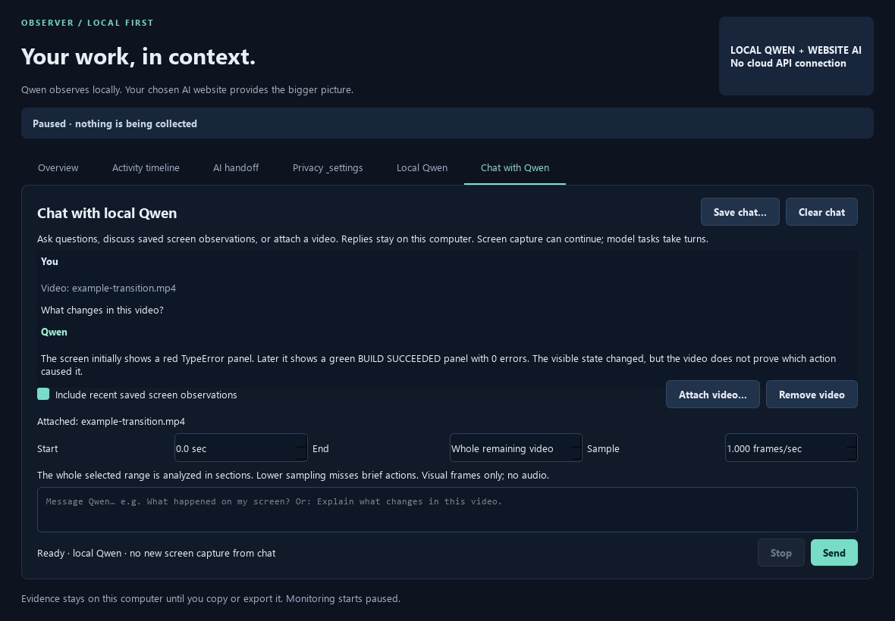
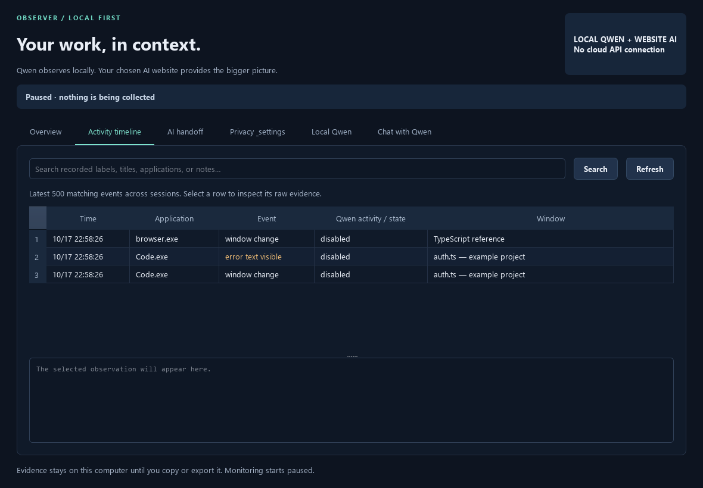

<p align="center"></p>

<p align="center">
<a href="https://github.com/simdsz1z/observer-ai/actions/workflows/ci.yml"></a>
<a href="LICENSE"></a>


</p>

<p align="center"><b>A local AI companion that watches your active window, remembers what happened, and lets you ask about it.</b></p>
<p align="center"><a href="#quick-start">Quick start</a> · <a href="docs/user-guide.md">User guide</a> · <a href="docs/benchmarks.md">Benchmarks</a> · <a href="CONTRIBUTING.md">Contribute</a></p>

Observer AI turns sampled screen activity into a searchable timeline using **Qwen3-VL running on your own computer**. Chat with the model, attach a video, or review and export context to the AI website you already use. No cloud AI API, API key, or automatic upload is involved.


<sub>Actual application UI with synthetic example data. The example conversation is illustrative.</sub>

## What you can do

| | |
|:--|:--|
| **Watch your workflow** | Analyze ordered video clips from the permitted active window, including passive reading and video playback. |
| **Ask Qwen directly** | Have local text conversations, optionally grounded in recent saved screen observations. |
| **Understand a video** | Attach a file, choose a range and sampling rate, and get chronological visual analysis. |
| **Keep useful memory** | Search a local SQLite timeline containing timestamps, application context, and structured model interpretations. |
| **Bring your own AI website** | Review a Markdown/JSON evidence package and manually share it with ChatGPT, Claude, DeepSeek, or another service. |
| **Control collection** | Start paused, require explicit capture consent, exclude apps/titles, set retention, and delete local memory. |

<details><summary><b>See the activity timeline</b></summary>
<br>

<p>Synthetic evidence. Native window facts and model interpretations remain separately identifiable.</p>
</details>

## Quick start

**Windows 10/11 x64 · Python 3.11+ · [uv](https://docs.astral.sh/uv/getting-started/installation/) · FFmpeg with ffprobe**

A Vulkan-capable GPU is recommended. The published measurements use an RTX 4070 Laptop GPU with 8 GB VRAM. CPU fallback is available but slower. This is a source release, with a prebuilt optional inference helper; there is no standalone app installer yet.

```powershell
git clone https://github.com/simdsz1z/observer-ai.git
cd observer-ai
uv sync --locked --extra dev
uv run python scripts/setup_observer.py
uv run python -m observer
```

Install FFmpeg if needed: `winget install --id Gyan.FFmpeg --exact`. Open a new terminal afterward. The app also detects the Gyan WinGet installation directly.

Setup downloads approximately **1.45 GiB of official Qwen weights**, the pinned llama.cpp Vulkan runtime, and the Observer helper. Downloads are hash-verified. Internet is needed for installation; inference runs locally afterward. The Windows helper is unsigned, and its source and SHA-256 checksum are included in the release.

1. Open **Local Qwen → Check installation**. **Test screen video** tests a generated sequence without capturing your desktop.
2. Set an optional goal, check capture consent, and select **Start recording**.
3. Work normally. **Pause recording** stops collection and releases the live model.
4. Review **Activity timeline**, open **Chat with Qwen**, or build a reviewed package in **AI handoff**.

After setup, double-click `run.cmd` to launch. For pip installation, configuration, privacy controls, and export details, see the [user guide](docs/user-guide.md). To build the helper yourself, see [runtime development](docs/resident-runtime.md).

## How it works

```text
Permitted active window → sampled frames → temporary video clip
                                              ↓
                                     local Qwen3-VL
                                              ↓
                                  validated interpretation
                                              ↓
                              SQLite timeline + local chat
                                              ↓
                                 reviewed manual AI handoff
```

The default groups **8 frames at about 1 frame/sec**. The **1-second video clips** preset targets **2 frames/sec, 2 frames per clip**. Video input uses native multimodal video decoding with ordered frames and timestamps. It is sampled visual understanding; audio is not analyzed.

The resident helper keeps model weights loaded between clips. Capture and inference overlap, with at most two clips waiting. When inference falls behind, older waiting clips are skipped and counted. Pause, cancellation, and timeouts clean up temporary media. See [architecture](docs/architecture.md), [live video](docs/live-video.md), and [chat](docs/chat.md).

## Measured performance

Short local tests on an **RTX 4070 Laptop GPU**, using the one-second preset:

| Workload | Original mean processing | Resident helper mean | Busy skips, before → after |
|:--|--:|--:|--:|
| Real video footage (~45 sec) | 7.75 sec/clip | **1.33 sec/clip** | 82% → **22%** |
| Live desktop (~61 sec) | 8.70 sec/clip | **1.28 sec/clip** | 81% → **17%** |

These are processing times, in addition to collecting each clip. The live runs used different real desktop activity, so they are indicative rather than a controlled accuracy comparison. The system **does not sustain one completed analysis every second**, and a 10-hour soak test has not been completed. See [methodology, counts, and resource measurements](docs/benchmarks.md).

## Privacy and current limits

- Collection starts paused on every launch. Only the permitted active window is sampled; there is no microphone, keylogger, clipboard history, or automatic computer control.
- Memory stays in `%LOCALAPPDATA%\ObserverAI`. Screenshot archiving is off by default; temporary visual input is still required for local inference. Default retention is 7 days.
- Exclusions, password detection, overlap masking, and text redaction are best effort. **Visible secrets may still reach the local model; text redaction does not redact pixels.** Local data is not encrypted by the app.
- Model descriptions can be wrong. Scores are model estimates, not calibrated probabilities. Tiny text and brief actions can be missed.
- Reviewed exports leave your computer only when you share them. Local chat is saved separately. Video analysis covers visual frames only.

Read the [full privacy and deletion behavior](docs/user-guide.md#privacy-and-local-memory) before monitoring sensitive work.

## Build with us

Observer AI is an early project. Useful next steps include longer stability tests, broader GPU benchmarks, better video context, and easier packaging. Reproducible bug reports and measured improvements are welcome.

```powershell
uv sync --locked --extra dev
uv run pytest -q
uv run python scripts/preview_ui.py
```

The automated suite uses synthetic evidence and mocked inference; it needs no downloaded model or desktop recording. [Contributing](CONTRIBUTING.md) explains optional real-model checks. See [open issues](https://github.com/simdsz1z/observer-ai/issues), [security reporting](SECURITY.md), and [third-party notices](THIRD_PARTY.md).

If local screen intelligence is useful to you, **star the repository** to help others find it, and share what you build.

**MIT licensed application code.** Built with [Qwen3-VL](https://huggingface.co/Qwen/Qwen3-VL-2B-Instruct-GGUF), [llama.cpp](https://github.com/ggml-org/llama.cpp), and [PySide6](https://doc.qt.io/qtforpython-6/). Model weights and dependencies retain their own licenses.
